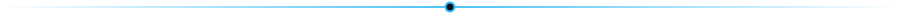
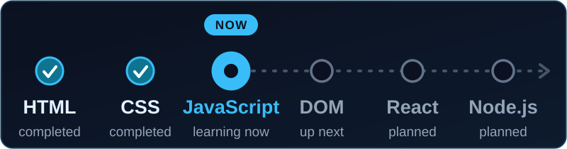
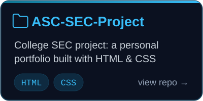
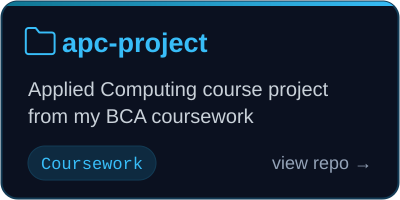
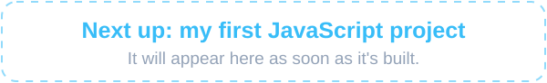

<!-- =========================================================
     FAIZAN SHAFI | GITHUB PROFILE README
     Theme: Midnight Navy / Cyan / Clean Developer Aesthetic
     Custom graphics live in /assets (journey, project cards, dividers)
========================================================== -->

  

  

  

    
    
    
    
  

  

    
    &nbsp;
    
  

## About Me

I'm a BCA student from Srinagar, building a strong foundation in web development one project at a time. I like understanding how websites work behind the scenes, and I learn best by experimenting with code and applying what I study.

| | |
|:--|:--|
| **Education** | Bachelor of Computer Applications (BCA) |
| **Location** | Srinagar, Jammu and Kashmir, India |
| **Interests** | Web development, software engineering, technology |
| **Approach** | Understand the fundamentals, practise consistently, build projects |
| **Current focus** | JavaScript fundamentals and front-end development |

## Learning Journey

  

 

| Covered so far | Practising now |
|:--|:--|
| HTML fundamentals and semantic structure | JavaScript fundamentals |
| CSS fundamentals, selectors, and layout basics | Variables, data types, and operators |
| Styling and organizing web pages | Programming logic and problem-solving |
| Git and GitHub basics | How JavaScript works with web pages |
| A personal portfolio built with HTML and CSS | Writing cleaner, better-organized code |

<b>See the full roadmap</b>

 

| Stage | Learning Area | Status |
|:--|:--|:--|
| 01 | HTML Fundamentals | Completed |
| 02 | CSS Fundamentals | Completed |
| 03 | JavaScript Fundamentals | **In progress** |
| 04 | DOM Manipulation | Up next |
| 05 | Browser APIs and Asynchronous JavaScript | Planned |
| 06 | React and Modern Front-End Development | Planned |
| 07 | Node.js and Back-End Fundamentals | Planned |
| 08 | Complete Web Applications | Long-term goal |

## Tech Stack

<table>
  <tr>
    <td align="center" width="50%">
      <b>Using now</b>  
        
      HTML5 · CSS3 · JavaScript (learning) Git · GitHub · VS Code
    </td>
    <td align="center" width="50%">
      <b>On the roadmap</b>  
        
      React · Node.js · Python Next, once the JavaScript fundamentals are solid
    </td>
  </tr>
</table>

## Selected Work

&nbsp;

  

  

## Goals

| Short-term | Long-term |
|:--|:--|
| Build a strong foundation in programming | Learn modern front-end development with React |
| Get confident with JavaScript and DOM manipulation | Explore back-end development and databases |
| Create responsive, interactive websites | Build complete projects independently |
| Keep building and publishing projects | Contribute to open-source projects |

## GitHub Activity

  

## Connect With Me

  I'm always interested in learning, building useful things, and meeting people who enjoy technology.

&nbsp;

  

### Learn with curiosity. Build with purpose. Improve every day.

